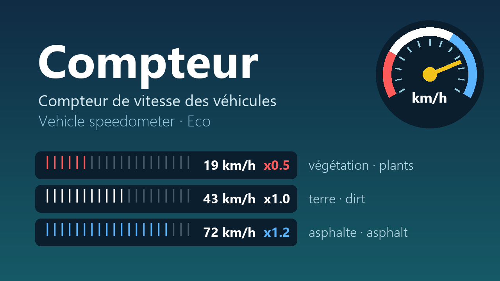

<p align="center"></p>

<p align="center"><a href="https://github.com/sponsors/nicolabcraft"></a></p>

# Compteur : un compteur de vitesse pour les véhicules d'Eco

Mod serveur pour **Eco** (Strange Loop Games). Pendant la conduite, l'aide du
véhicule affiche une jauge, la vitesse et le bonus du sol :

```
||||||||||||||||||||  42 km/h  x1.2
```

| Couleur | Sol | Exemple |
|---|---|---|
| **Rouge** | ralentit (sous x1) | végétation, débris d'arbres |
| **Blanc** | normal (x1) | terre, herbe, eau |
| **Bleu** | accélère (au-dessus de x1) | route en pierre (x1.1), asphalte (x1.2) |

Tout est calculé par le serveur : **rien à installer pour les joueurs**. Le
compteur apparaît pendant la conduite ; l'aide d'origine du véhicule revient quand le
conducteur descend. Fonctionne avec tous les véhicules et bateaux, y compris ceux des
autres mods.

*[English below](#english)* · [Changelog](CHANGELOG.md) · [Contribuer / Contributing](CONTRIBUTING.md)

## Installation

Téléchargez `Compteur-<version>.zip` dans les [Releases](../../releases) et
décompressez-le **à la racine du serveur**, puis redémarrez. Pas de DLL, pas de
réglage :

```
Mods/UserCode/Compteur/*.cs        le mod (compilé par le serveur au démarrage)
```

Au démarrage, le journal du serveur affiche `[Compteur] speedometer started`.
Pour le retirer : supprimez `Mods/UserCode/Compteur/` et redémarrez.
Compatibilité : Eco 0.14.2.1.

## Fonctionnement

- Quatre fois par seconde, le serveur regarde qui conduit quel véhicule.
- La **vitesse** vient du trajet parcouru pendant la dernière seconde : elle
  réagit avec environ une demi-seconde de retard.
- Le **bonus du sol** vient du bloc sous le véhicule : les routes ont un bonus
  (`Road`, x1.1 ou x1.2), la végétation et les débris un malus
  (`MoveEfficiency`, x0.3 à x0.8).
- La **jauge** va de zéro à la vitesse maximale du véhicule sur la meilleure route.

La jauge est faite de texte coloré, pas d'une aiguille : l'aide du véhicule est
le seul endroit de l'écran qu'un mod serveur peut remplir pendant la conduite.

## Développer

```bash
dotnet build -c Release            # aucun serveur Eco nécessaire (paquet NuGet officiel)
node tools/package.mjs             # release/Compteur-<version>.zip
```

Le compilateur du serveur reste plus strict (pas de `Console`, références
limitées) : le test final est le démarrage d'un serveur. La CI GitHub refait
ces vérifications à chaque contribution et publie une release à chaque tag
`v*`. Voir [CONTRIBUTING.md](CONTRIBUTING.md).

## Soutenir le projet

Compteur est gratuit et le restera. Si le mod vous rend service, vous pouvez
soutenir son développement sur [GitHub Sponsors](https://github.com/sponsors/nicolabcraft) :
cela aide à maintenir le mod à jour avec les nouvelles versions d'Eco. Signaler
un bug ou contribuer du code aide tout autant : voir [CONTRIBUTING.md](CONTRIBUTING.md).

## Licence

Gratuit et à code ouvert, sous **PolyForm Noncommercial 1.0.0** (`LICENSE.md`) :
utilisez-le, modifiez-le, partagez vos versions, mais **jamais à des fins
commerciales**. Eco est un jeu de Strange Loop Games ; ce mod est un projet
communautaire indépendant.

---

## English

**Compteur** adds a speedometer to Eco vehicles. While driving, the vehicle's
control hint shows a gauge, the speed in km/h and the ground multiplier:
**red** below x1 (plants, tree debris), **white** at x1 (dirt, grass, water),
**blue** above x1 (stone road x1.1, asphalt x1.2). Everything runs on the
server, so players install nothing. It shows while driving, and the vehicle's
original hint comes back when the driver gets out. It works with every vehicle and
boat, modded ones included.

**Install**: download `Compteur-<version>.zip` from the [Releases](../../releases),
unzip it at the server root (`Mods/UserCode/Compteur/`) and restart. The server
log shows `[Compteur] speedometer started`. Compatibility: Eco 0.14.2.1.

**How it works**: four times per second the server checks who drives what.
Speed comes from the distance covered in the last second (about half a second
of lag). The multiplier comes from the block under the vehicle (`Road` bonus,
`MoveEfficiency` penalty). The gauge spans from zero to the vehicle's top speed
on the best road. It is coloured text rather than a needle: the control hint is
the only on-screen spot a server mod can fill while driving.

**Develop**: `dotnet build -c Release` (no Eco server needed), then
`node tools/package.mjs`; see [CONTRIBUTING.md](CONTRIBUTING.md#english).

**Support the project**: Compteur is and will stay free. If it helps your
server, you can support its development on
[GitHub Sponsors](https://github.com/sponsors/nicolabcraft).

**License**: free and source available under **PolyForm Noncommercial 1.0.0**:
use it, modify it, share your versions, but never use it commercially. Eco is a
game by Strange Loop Games; this mod is an independent community project.
